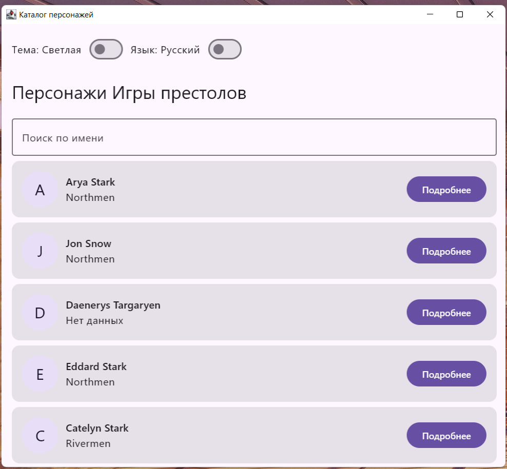
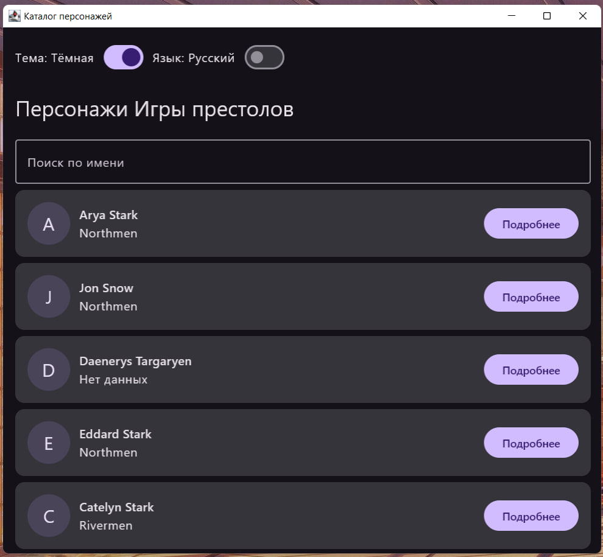
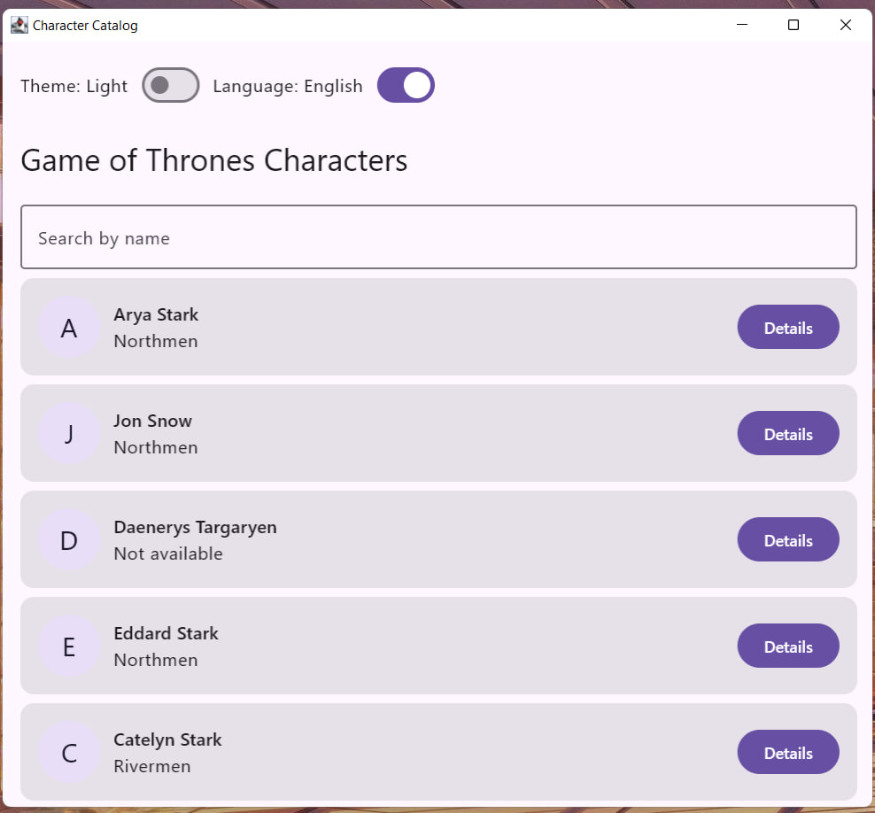
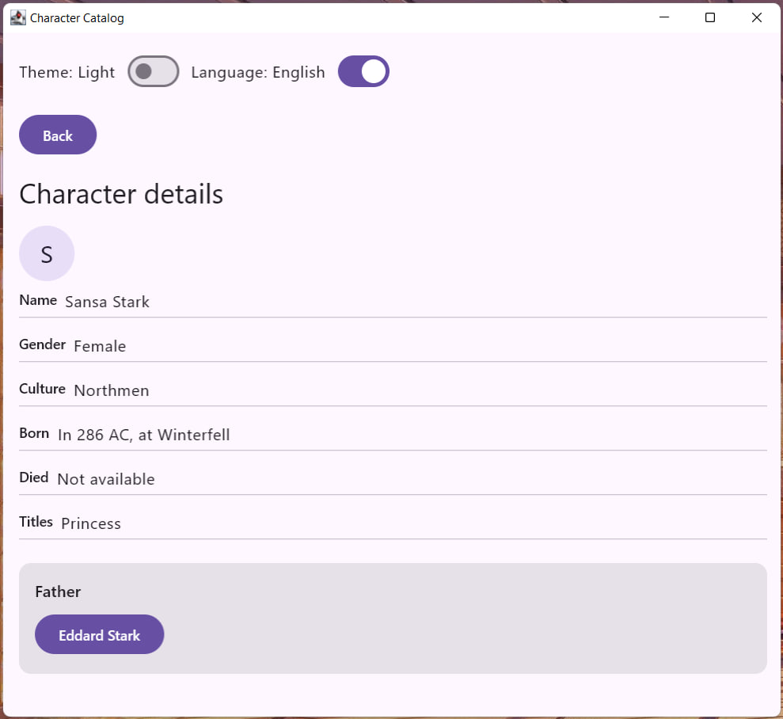
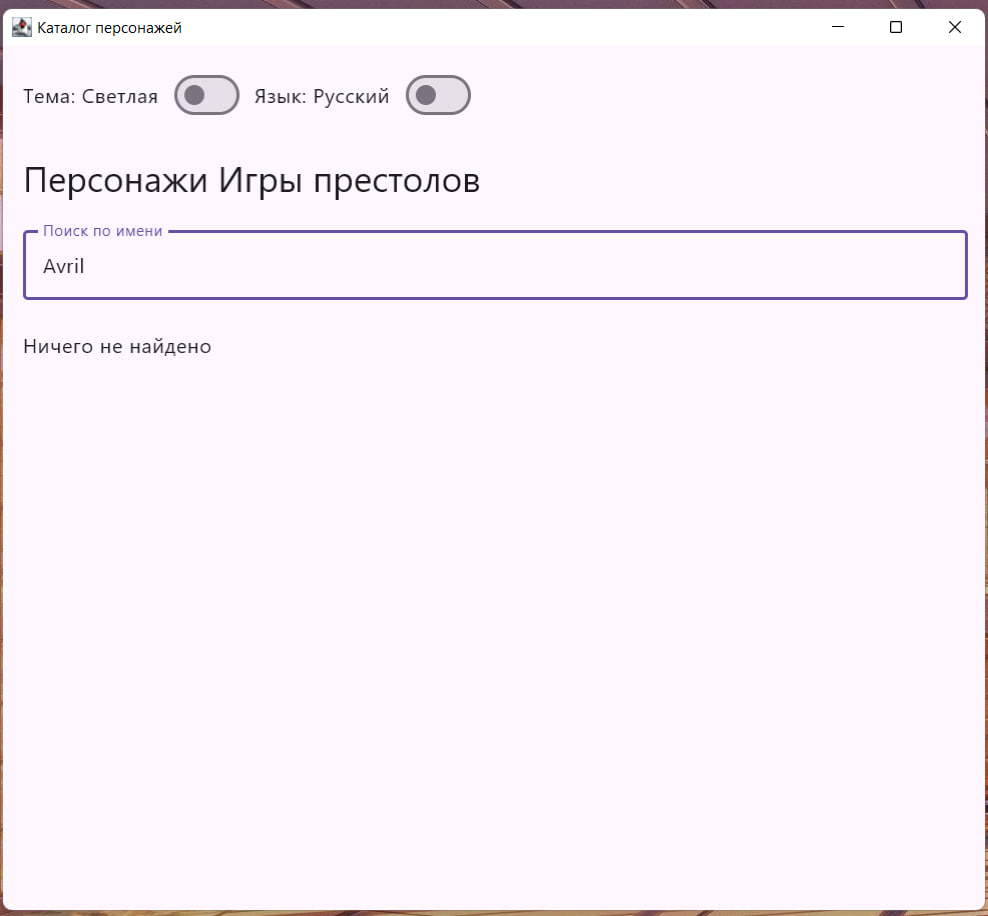

# Каталог персонажей «Игры престолов»

Учебное кроссплатформенное приложение на Kotlin Multiplatform и Compose Multiplatform, выполненное для лабораторной работы № 1.

Приложение показывает каталог персонажей вселенной «Игры престолов». В текущей версии используются локальные тестовые данные из 20 записей. Сетевые запросы и сохранение данных на диск не используются.

## Возможности

- просмотр списка персонажей;
- поиск персонажа по имени;
- отображение заглушки вместо изображения;
- просмотр подробной информации о персонаже;
- переход к отцу персонажа, если он указан в исходных данных;
- возврат к списку с сохранением запроса и положения прокрутки;
- переключение светлой и тёмной темы;
- переключение русского и английского языка;
- обратная анимация при возврате на предыдущий экран.

## Скриншоты

### Каталог

| Светлая тема | Тёмная тема | Английский язык |
| --- | --- | --- |
|  |  |  |

### Детальная информация и поиск

| Связь с отцом персонажа | Пустой результат поиска |
| --- | --- |
|  |  |

## Использованные технологии

- Kotlin Multiplatform;
- Compose Multiplatform и Material 3;
- Navigation 3;
- ViewModel, StateFlow и корутины;
- Compose Resources для локализации интерфейса.

## Структура проекта

- `shared` — общий код, экраны, состояние, навигация, ресурсы и тестовые данные;
- `desktopApp` — точка запуска версии для компьютера;
- `androidApp` — приложение для Android;
- `webApp` — приложение для браузера;
- `iosApp` — проект приложения для iOS;
- `tools` — проверка совпадения ключей локализации.

## Запуск на компьютере

Windows:

```powershell
.\gradlew.bat :desktopApp:run
```

macOS и Linux:

```bash
./gradlew :desktopApp:run
```

## Сборка Android-приложения

```powershell
.\gradlew.bat :androidApp:assembleDebug
```

На macOS и Linux используется та же задача через `./gradlew`.

## Запуск в браузере

```powershell
.\gradlew.bat :webApp:wasmJsBrowserDevelopmentRun
```

На macOS и Linux:

```bash
./gradlew :webApp:wasmJsBrowserDevelopmentRun
```

## Проверка локализации

```powershell
python tools\check-strings.py
```
